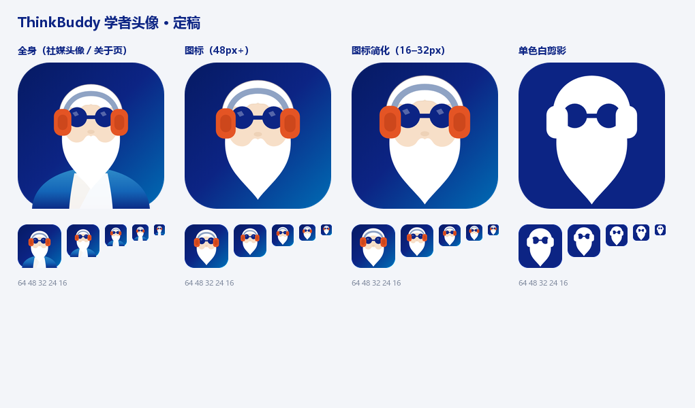
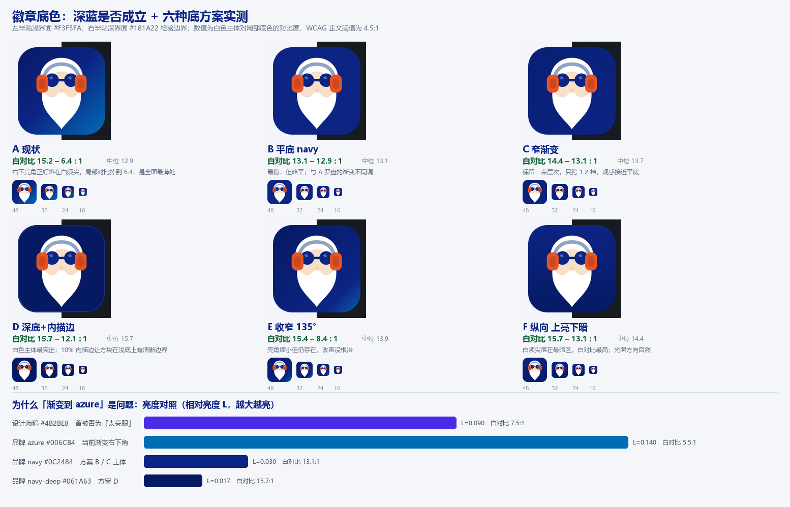
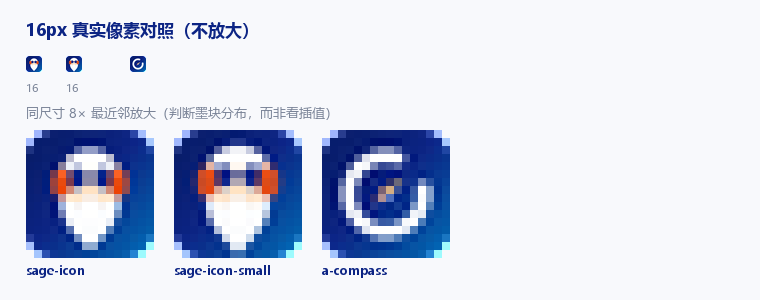
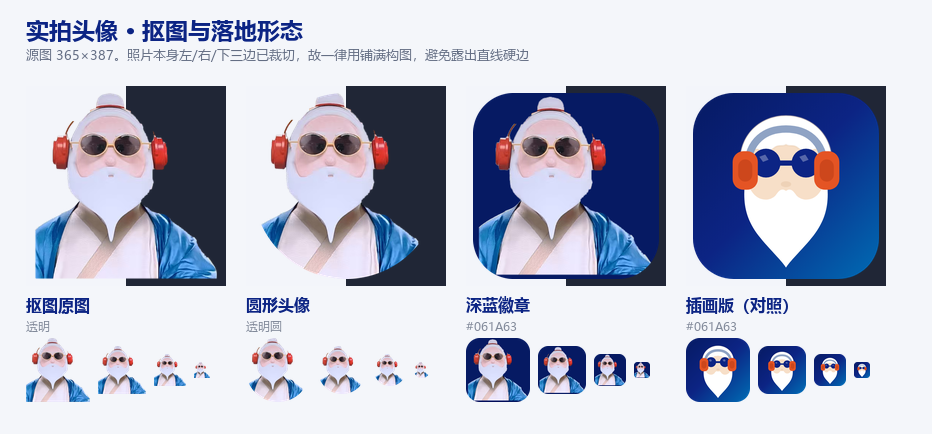

# 学者头像（Sage Avatar）—— 定稿与原理

> 起因：用户提供两张日式吉祥物风格参考图（白须老人 + 圆墨镜 + 红色头戴耳机），问「可以做成这样的卡通头像吗？」
> 结论：**可以，而且这一版恰好解开了上一轮「苏格拉底人像做不了图标」的死结。**
> 关键不在画法，在于识别负载从**五官**换成了**道具**。



## 一、为什么上一轮失败、这一轮成立（机制）

`socrates/README.md` 记录的失败原因是「信息预算」：一张能认作脸的最小图形需要 头形 + 2 眼 + 鼻 + 须 = 5 个可分辨墨块，
而 16px 只够容纳 3～5 个 1～1.5px 的笔触——纹理级的五官必然在此预算内互相吞并，退化成团块。

参考图给出的是另一条路：它**根本不靠五官携带身份**。

| 元素 | 16px 下的形态 | 是否为识别点 |
|---|---|---|
| 两片圆墨镜 | 2 个深色圆点（可合并成一条墨镜带） | ✅ 主识别 |
| 两只红色耳机罩 | 2 个暖色方块（左右对称） | ✅ 主识别 |
| 白发白须 | 1 个白色外壳轮廓 | ✅ 副识别（剪影） |
| 眼睛、眉毛、褶皱 | 消失 | ❌ 不计入预算 |

也就是说，**它把信息预算从 5 项压到 3 项**（2 圆 + 2 块 + 1 壳），且每一项都是面积驱动的纯色块，不依赖笔画精度。
这是「脸做不到、道具做得到」的物理原因，不是手感问题。

顺带满足母品牌纪律：耳机罩的红橙（`#E45424`）是画面里唯一的暖色，面积约 4%——正好落在
`README.md §一` 定下的「暖色 ≤ 5%，只做点睛」区间内，比 A 罗盘的单支暖针略高，但仍在一个量级。

## 二、形象语义

不是「苏格拉底」，是**学者 / 提问者**（Sage）。这个更名是有意的：

- 苏格拉底的形象识别依靠符号（`Σ`、希腊铭文、卷发大胡子），不存在于现代视觉记忆里；
- 而「白须 + 圆墨镜 + 耳机」是现代语境下「沉浸思考的长者」的通用符号——耳机尤其重要，
  它直接指向**聆听与对话**（ThinkBuddy 的产品动作），并把形象从「古代雕像」拉进「正在使用工具」的当下。
- 圆墨镜是取舍标记：看不见世界，所以专注。与 A 罗盘「方向已定」是同一种态度，两种表达。

一句话：**罗盘 = 产品的动作（判断方向）**，**学者 = 产品的陪伴者（一起想）**。两者不冲突，可分工。

## 三、底色：深蓝成立，但渐变方向反了



结论先说：**深蓝作底完全成立**——它就是母品牌的主色，白对底 6.4–15.2 : 1，全部远超 WCAG 正文阈值 4.5:1。
真正有问题的不是「深蓝」，是**当前 135° 全跨渐变的方向**：

| 实测 | 相对亮度 L | 白对比 |
|---|---|---|
| 设计师稿 `#4B2BE8`（曾被否为「太亮眼」） | 0.090 | 7.5 : 1 |
| 品牌 azure `#006CB4`（当前渐变右下角） | 0.140 | 5.5 : 1 |
| 品牌 navy `#0C2484` | 0.030 | 13.1 : 1 |
| 品牌 navy-deep `#061A63` | 0.017 | 15.7 : 1 |

**渐变右下的 azure 角，亮度是那个被否掉的紫蓝的 1.5 倍。** 换句话说，把「太亮眼」压掉了主体，却在角上放了更亮的一块。

叠加第二个问题：白须尖正好落在右下亮区（y=478 处底色 `#07469B`），白对底从左上 15.2 掉到 6.4——
**全图最细的形，配了全图最弱的对比**。这是方向问题，不是颜色问题。

六个备选（`bg-options.png` 逐格有实测值）：

| 方案 | 底色 | 白对比 | 评价 |
|---|---|---|---|
| A 现状 | 135° `#061A63→#0C2484→#006CB4` | 6.4–15.2 | 亮角与主体争视线，16–32px 显脏 |
| B 平底 | `#0C2484` | 12.9–13.1 | 最稳，略平，与 A 罗盘渐变不同调 |
| C 窄渐变 | `#081F73→#0C2484` | 13.1–14.4 | 留层次不伤对比，观感接近平底 |
| **D 深底+内描边** | `#061A63` + 白色 10% 内描边 | 12.1–15.7 | **推荐**：白主体最突出，浅底上边界清晰 |
| E 收窄 135° | `#061A63→#0C2484→#0A5FAE` | 8.4–15.4 | 改善未根治，仍留亮角 |
| F 纵向 | `#0C2484→#061A63`（90°） | 13.1–15.7 | 白须尖落暗区，光照自然；次选 |

D 与 A 罗盘形成有意的分工：**图标用渐变（产品感），头像用哑光深底（人像感）**——头像本就是「拍在纯色背景上的肖像」，不是「发光的产品图标」。
若要求与 A 罗盘完全同调，改选 C。

> 头肩版（`sage-avatar`）上另有一条约束：外袍底端 `#0B2C86` 与 navy `#0C2484` 几乎同色，底色越浅袍子反而越糊。
> 实测袍缘对比：D 3.58 : 1 > F 3.46 > E 3.22 > C 3.16 > A 3.00 ≈ B 2.99。这一项也指向「底色选深」。

## 四、使用边界（四档资产）

| 变体 | 构图 | 适用尺寸 | 用途 |
|---|---|---|---|
| `sage-avatar` | 头 + 肩（蓝外袍 + 白内衬直裾） | ≥ 96px | 社媒头像、关于页、空状态插图、引导页 |
| `sage-icon` | 头部特写，填满徽章 | ≥ 48px | 应用内头像、文档页眉、PPT 封面 |
| `sage-icon-small` | 简化头部 + 放大比例 | 16–48px | 小图标场景的**备选**（见 §六） |
| `sage-mono` | 单色白剪影（深蓝底） | 单色场景 | 印刷、烫金、单色 UI、与 A 罗盘并列时的从属层 |

**不要用**：作为 `.ico` 主图标（理由见 §六）；在 16px 位置与 A 罗盘同时出现（两个记忆点互相削弱）。

## 五、色彩 Token（源自母品牌实测色板，无新增色）

| 元素 | 色值 | 说明 |
|---|---|---|
| 徽章底 | `#061A63` → `#0C2484` → `#006CB4` | 135° 品牌渐变，与 A/B/C 完全一致 |
| 外袍 | `#2E8AC8` → `#1466B8` → `#0B2C86` | 同一冷色族，纵向渐变模拟衣褶 |
| 墨镜 / 镜桥 | `#0C2484`（navy） | 用主色而非纯黑，避免与背景脱开 |
| 耳机罩 | `#E45424`（ember）+ `#B93C16` 内片 | 全画唯一暖色，≤ 5% |
| 耳机头带 | `#8FA3C4` | 冷灰蓝，压住白发的膨胀感 |
| 肤色 | `#F7DFC8` / 影 `#E2C1A0` | 低饱和暖肤，不抢耳机 |
| 发 / 须 / 内衬 | `#FFFFFF` | 与徽章形成最高对比，承担剪影识别 |

## 六、16px 真实对照（诚实结论）



不看矢量缩放，只看渲染出来的真实 16px 像素：

| 标记 | 16px 读数 | 判定 |
|---|---|---|
| `sage-icon` | 白色外壳 + 一条深色横带 + 两点橙，能读出「戴耳机的人」 | 可用，但边缘偏软 |
| `sage-icon-small` | 同上，白壳更饱满、橙块更大，抗糊更好 | **sage 系里 16px 最强** |
| `a-compass` | 圆环 + 暖针点，结构极干净 | **仍是三者中最清晰** |

**结论不变**：`.ico` 主图标继续用 A 罗盘。sage 系不争夺 16px 这个位置——它争的是「用户愿意把它当头像」这件事，
而头像永远 ≥ 48px。

若最终决定让学者上位为应用图标，用 `sage-icon-small`，不要用 `sage-icon` 或 `sage-avatar`。

## 七、被否决的迭代（避免重复试错）

| 版本 | 现象 | 原因 |
|---|---|---|
| v1 | 耳机消失、胡须消失 | 耳机画在脸之前被脸覆盖；胡须与脸同色 |
| v3 | 白须与白发连成一片，脸几乎被白吃掉；单色版只剩墨镜，读作**领结** | 胡须比例过度修正，白对白无分隔 |
| 双白斜襟收领 | 读作西装 / 领带 | 两条白斜线夹一个深蓝三角 = 西装的视觉公式 |
| 耳机头带画在发外 | 读作**光环 / 天使光圈** | 弧线顶点超出发的剪影 |
| 单色版胡须用徽章色填充 | 胡须整块消失 | `fill` 误用了底色而非白色 |

修正后：头带顶点拉进发内（`M 152 214 C 154 140 202 110 256 110 …`，宽 20）；
胡须上缘加人中缺口（Q 曲线内凹）分开左右两撇；领口改为汉服式白色直裾内衬，取消斜襟。

## 八、实拍照片：抠图与落地



参考图本身就是实拍（有人穿着这套造型在活动现场拍的），所以另做了一份**照片版头像**，与插画版并存。

| 文件 | 形态 | 用途 |
|---|---|---|
| `photo/sage-photo-cutout.png` | 透明底整图（351×358 主体） | 二次构图、贴任意底 |
| `photo/sage-photo-circle-{64…512}.png` | 圆形头像，透明圆外 | 社媒 / IM 头像 |
| `photo/sage-photo-badge-{64…512}.png` | 圆角方形 + `#061A63` 底 | 与插画版同形的应用内头像 |
| `photo/photo-sheet.png` | 对照表（含 16/32/48/64 阶梯） | 选型用 |

**抠图过程与两个必须处理的坑**：

1. 模型抠图后**左上残留一整块黄招牌**（约 5.9k 像素），且与主体通过一根细吊线连通，连通域法拆不开。
   解法：按颜色剔除招牌（黄 `R>150 & B<115 & R-B>90`；绿 `G-R>28 & G-B>28`）并膨胀 2px，细线断开后再取最大连通域。
2. **源图左/右/下三边已被裁切**，主体直接贴边。任何「留边距」的构图都会在徽章内部露出直线硬边。
   解法：一律用 **cover 铺满**构图，让裁切边落到画布之外；照片的 alpha 边界是透明的，不产生接缝。

源图仅 365×387，抠图保留原始分辨率未放大——放大只会糊，需要更大尺寸应换原始大图。

## 九、文件

```
sage/
├─ svg/                              矢量源（唯一事实源，改这里再跑脚本）
│   ├─ sage-avatar.svg               头 + 肩
│   ├─ sage-icon.svg                 头部特写
│   ├─ sage-icon-small.svg           16–32px 光学版
│   └─ sage-mono.svg                 单色白剪影
├─ png/                              每档 512/256/128/64/48/32/24/16 + 512 源
├─ ico/thinkbuddy-sage.ico           16/24/32/48/64/128/256（备选，非主图标）
├─ photo/                            实拍版抠图与圆形/徽章落地（见 §八）
├─ preview.png                       四档 215px + 尺寸阶梯
├─ preview-16px.png                  真实 16px 与 8× 放大对照
└─ bg-options.png                    六种徽章底色的实测对照（见 §三）
```

## 十、授权

`svg/` `png/` `ico/` 全部为原创矢量绘制，无第三方素材；形象灵感来自用户提供的参考图，仅借鉴「道具承载身份」的构图逻辑，图形全部重新绘制。

`photo/` 下为团队成员实拍照片抠图，**肖像权归本人**。对外物料使用前需取得本人同意；不用于任何暗示代言的场景。

---

**待用户决策**（两项）：

1. 徽章底色用 **D `#061A63` 哑光 + 内描边**（推荐）还是 **C 窄渐变**（与 A 罗盘同调）。定了之后重导全部 SVG/PNG/ICO。
2. `.ico` 主图标用 A 罗盘（推荐，16px 最强）还是 `sage-icon-small`（人格统一，16px 稍软）。
   决定后需四处同源替换：`desktop-shell/assets/icon.ico`｜`brand/logo/thinkbuddy-icon.ico`｜
   `brand/logo/thinkbuddy-icon.png`｜`web/public/logo.png`。
