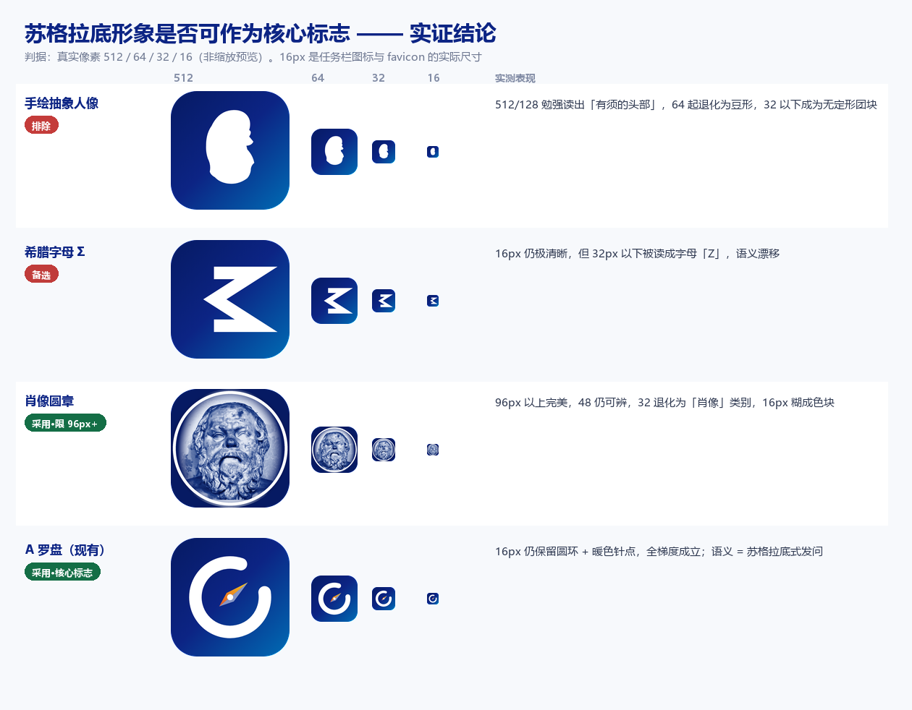

# 苏格拉底形象可否作为核心标志 —— 实证记录

> 起因：希望能从苏格拉底的头像中抽象出一个形象，作为 logo 内部的核心标志。
> 结论：**作为 16px 的核心图标，不能；作为 96px 以上的品牌人格资产，能。**
> 本文记录 10 个方向、4 组真实像素测试的完整过程与判定依据，供后续不再重复试错。



## 一、判据（先说标准，再说结论）

一切判断只看**真实像素**，不看矢量预览的缩放效果：

- 渲染管线：SVG/位图 → 无头 Chrome 512px 截图 → PIL 预乘 alpha 降采样（避免透明边暗边）
- 检验档位：512 / 128 / 96 / 64 / 48 / 32 / **16**
- **16px 是硬门禁**：它是 Windows 任务栏、资源管理器小图标、favicon 的实际尺寸。一个核心标志在 16px 失效，就等于在用户每天看见它的地方失效。

这条门禁是 A 方案（罗盘）当初定下的，对任何新方向一视同仁。

## 二、结论

| 方向 | 16px | 96px+ | 判定 |
|---|---|---|---|
| 手绘抽象人像（侧面纯剪影） | 无定形团块 | 勉强读出「有须的头部」，64px 起退化为豆形 | 排除 |
| 正面剪影（含极简版） | 团块 | 读作石块 / 麻袋 / 面包，不读作人 | 排除 |
| 墨刻式面具（白形 + 挖空笔触） | 糊 | 128px 成立，但读作「光头修士」，不像苏格拉底 | 排除 |
| 希腊字母 Σ | 极清晰 | 极清晰 | 备选，但 32px 以下被读成「Z」 |
| 肖像圆章（真实雕像 + 双色调） | 糊成色块 | 完美 | **采用，限 96px 以上** |
| A 罗盘（既有方案） | 仍有圆环 + 暖色针点 | 成立 | **采用，作为核心标志** |

## 三、为什么手绘人像必然失败（机制，而非手感）

失败不是参数没调好，而是三条结构性原因：

1. **信息预算不够。** 一张能认作「脸」的图形至少需要：头形轮廓 + 2 眼 + 鼻 + 胡须 = 5 个可分辨墨块。16px 的像素预算只够 3～5 个，且每条笔触只有 1～1.5px。
2. **轮廓承载不了身份。** 纯剪影实验（`r9`）证明：正面剪影完全读不出人头（左右对称 + 圆顶圆底 + 毛边 = 一块无定形物体）；侧面剪影只能撑到 64px。
3. **我能认出苏格拉底靠的是符号，不是他的脸。** 即使 128px 成立，读出的也只是「一个老人」。一个泛指的老年男性形象对品牌是**负资产**——它同样能指理发店、律所、银行，不指向「苏格拉底」，也不指向「提问」。

推论：**如果坚持人脸进图标，16px 就必然要换一张图，标志的识别记忆点随之断裂。** 这不是妥协能解决的，是尺寸的物理下限。

## 四、为什么肖像圆章成立

改用真实雕像后，问题从「怎么画得像」变成「怎么让照片服从品牌色」。关键的三次方法论修正：

1. **换输入，而不是加处理。** 原先用的卡比托利欧像是带花纹墙纸的室内照，任何径向衰减、抠图、羽化都分不开「墙纸」和「头」——二者空间相邻、亮度接近。换成**黑底**的卢浮宫像（`a_louvre.jpg`）后，背景在双色调映射里天然变成深海军蓝，与徽章底色同色，**抠图问题直接消失**。
2. **黑底照片的独门优势：画黑不掉痕迹。** 底座的亮边直接用黑色涂掉即可，无需蒙版。
3. **色阶二值化在有大理石纹理的物体上无效。** 三阶/五阶墨块版（`r13` 的 B/C）实测变成「地衣 / 迷彩」——模糊 + 分阶放大的是**纹理**，不是**形体**。要把石像变成墨块，只能靠结构感知分割或人工描摹，后者已证明不可行。

最终做法：拉对比 → 双色调（深海军蓝 → 中性石白）→ 圆形裁切 → 细白环 → 深底徽章。中调刻意压向青灰，避免「蓝光雕塑」的电子感。

## 五、使用边界（重要）

| 用 | 不用 |
|---|---|
| 启动页 / 关于页 / 版本信息 | **应用图标 / .ico / favicon** |
| 空状态、引导页插图 | 任务栏、窗口标题栏 |
| 文档页眉、生成内容水印（96px+） | 任何 < 96px 的位置 |
| 官网 hero、社媒头像、周边 | 与 A 罗盘同时出现在同一视口 |

**图标与人格资产分工**：核心图标 = A 罗盘（16px 成立，语义 = 苏格拉底式发问）；苏格拉底肖像 = 产品人格层（讲故事用，不承担识别）。Logo 不承担纪念性，纪念性交给肖像。

## 六、文件

```
socrates/
├─ portrait-medallion-dark.png        1000px 源
├─ portrait-medallion-dark-{512,256,128}.png
├─ portrait-medallion-light.png       浅底（文档 / 关于页）
├─ portrait-medallion-light-{512,256,128}.png
├─ verdict.png                        结论对照表
├─ preview.png                        深/浅底 + 实际尺寸对照
└─ rejected-handdrawn/                被否决的手绘版（鸟头/修士），仅作证据留档，勿使用
```

深底版：深海军蓝徽章 + 白色细环 + 圆形肖像，用于深色界面。
浅底版：白色徽章 + 内嵌深蓝圆盘，用于浅色文档页，不会在纸白上「挖一个黑洞」。

## 七、授权提醒

雕像是古代作品，本身属公有领域；但**照片有独立授权**。本轮使用的参考照片来自 Wikimedia Commons，商用前请核对原文件页的许可条款（多数为 CC BY-SA，需要署名并以相同方式共享）。若要正式商用，建议自行拍摄或换用明确标注 PD / CC0 的照片。

## 八、备选：希腊字母 Σ

卡比托利欧像基座刻着 ΣΩΚΡΑΤΗΣ，首字母 Σ 是纯几何结构（两段斜画 + 上下横画 + miter 接角），**16px 依然清晰**，是唯一能同时满足「指向苏格拉底」和「跑得动 16px」的字形方案。

但它有两个未解问题，故未推进：

- 32px 以下被读成字母「Z」，语义漂移；
- 它是字标（monogram），与美工三稿的图形语言（罗盘 ?／丝带 t／对话 +）不同族，混用会分裂品牌。

若后续想做「字标 + 图形标」双轨体系，Σ 是合理起点。
